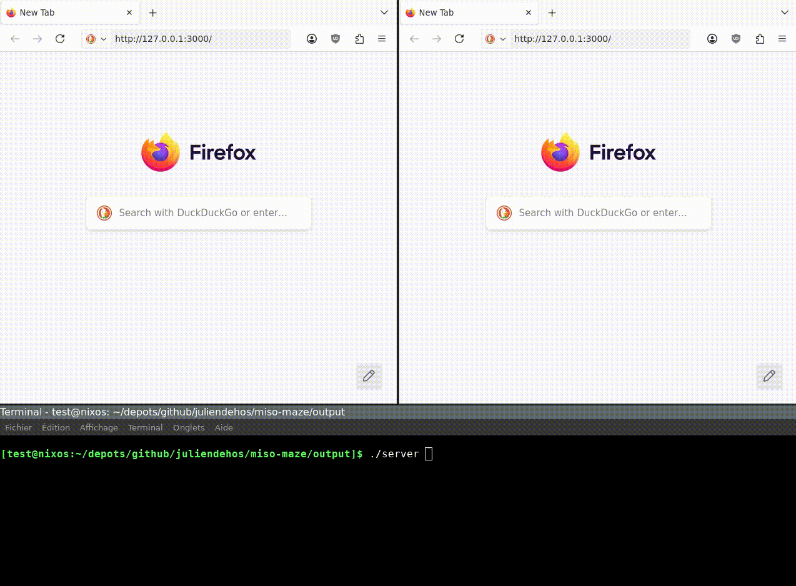

# miso-maze

Isomorphic web app using [Miso](https://github.com/dmjio/miso) and WebSockets:
move inside the maze and meet other players.



## Build and run:

```
build.sh
cd output
./server
```

then go to 127.0.0.1:3000

## Development

- frontend:

```
nix develop .#wasm
make
```

- backend:

```
nix develop .#default 
cabal update            # update cabal
cabal test              # build and run tests
cabal run server        # build and run the server
```

